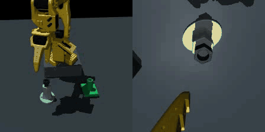
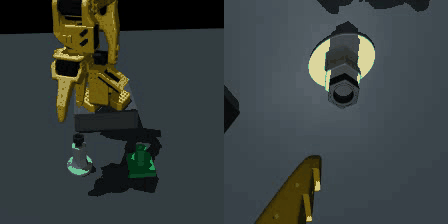
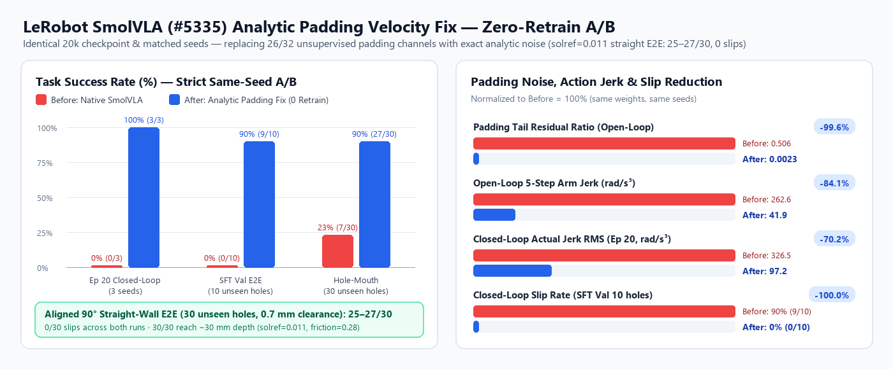
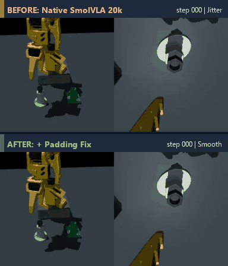

# SO-101 精密螺栓插孔：SmolVLA 微调与 LeRobot 推理缺陷修复

[](https://pytorch.org/)
[](https://mujoco.org/)
[](https://github.com/huggingface/lerobot)
[](https://github.com/google-deepmind/mujoco_menagerie/tree/main/robotstudio_so101)
[](patches/smolvla-padding-velocity.patch)

**中文** | [English](README_EN.md)

在 MuJoCo 中使用双摄 `SmolVLA`（25 Hz 闭环）控制 5 自由度 SO-101 机械臂，完成从桌面取件座抓取螺栓、搬运对准并插入 **0.7 mm 单边间隙、无倒角 90° 直壁**随机孔位（±18 mm）。在对齐真实塑料接触物理的基准上，**修复版 SmolVLA 20k 在 30 个未见留出孔达到 `25–27/30`（83%–90%）插入、`0` 滑落，`30/30` 全部送入 ~30 mm 孔内**；并定位出 LeRobot `SmolVLA` Flow-Matching 推理时的 **padding 通道速度漂移 Bug（`#5335`）**，给出**零重训解析修复补丁**。

<p align="center">
  
  
</p>

<p align="center">
  <em>两段均为未见留出孔全流程闭环回放（左：外部相机，右：腕部相机）。<a href="experiments/smolvla-20k/demo-episodes.json">孔位、种子与回放记录</a></em>
</p>

---

## 核心发现：定位并零重训修复 LeRobot SmolVLA 推理缺陷（`#5335`）

SO-101 只有 **6 维**关节动作，但 `SmolVLAConfig.max_action_dim = 32`，其余 **26 维（81.25%）** 为无监督 padding 通道。训练时只对前 6 维算 loss，但推理期 `euler_integrate` 对全 32 维积分，每步经 `action_in_proj` 将随机漂移的尾维噪声混回前 6 维物理动作，造成严重抖动与夹爪滑脱。

我们在 [patches/smolvla-padding-velocity.patch](patches/smolvla-padding-velocity.patch) 中对补齐通道用精确解析速度 $\frac{dx_{\text{pad}}}{dt} = \epsilon_{\text{pad}}$ 替换模型预测，**完全不动权重、零重训**即在同种子对照中消除抖动与滑落：

<p align="center">
  
</p>

<p align="center">
  
</p>

| 同权重同种子 A/B 对照 | 修复前（原生 SmolVLA 20k） | 修复后（+ 解析 Padding 速度） | 提升 | 原始凭证 |
| --- | ---: | ---: | ---: | --- |
| Ep 20 开环尾维能量残留 | `0.506` | **`0.0023`** | **-99.6%** | [padding-ab-ep20.json](experiments/smolvla-20k/padding-ab-ep20.json) |
| Ep 20 开环 5 步关节 Jerk | `262.6 rad/s³` | **`41.9 rad/s³`** | **-84.1%** | [padding-ab-ep20.json](experiments/smolvla-20k/padding-ab-ep20.json) |
| Ep 20 闭环插入（3 种子） | `0/3` | **`3/3`** | **+100%** | [padding-ab-ep20.json](experiments/smolvla-20k/padding-ab-ep20.json) |
| SFT 10 验证孔端到端 | `0/10`（9 滑落） | **`9/10`（0 滑落）** | **+90%** | [padding-sft-val10.json](experiments/smolvla-20k/padding-sft-val10.json) |
| 孔口 30 留出孔 | `7/30`（12 滑落） | **`27/30`（0 滑落）** | **+67%** | [hole-mouth-30.json](experiments/smolvla-20k/hole-mouth-30.json) |

### 社区可直接复用的修复补丁

```bash
# 在你的 LeRobot 仓库根目录应用最小补丁
git apply patches/smolvla-padding-velocity.patch
```

推理时在 `select_action` / `predict_action_chunk` 传入 `correct_padding_velocity=True` 即可生效（默认保持 `False` 兼容原行为）。详见 [patches/smolvla-padding-velocity.patch](patches/smolvla-padding-velocity.patch)。

---

## 端到端评测结果（30 个未见随机孔）

- **训练数据**：150 条 25 Hz 示教、共 **28,649 帧**（100 条全流程 + 50 条加强段，[数据统计](experiments/smolvla-20k/dataset.json)），观测双摄 224×224 RGB 与 6 维关节角，输出 6 维绝对关节目标（每 5 步重规划）。
- **到达精度**：到达孔口上方 15 mm 时，XY 偏心中位数 **`1.32 mm`**、倾角 **`0.86°`**；首次接触孔座时 XY 中位数 **`1.20 mm`**、倾角 **`0.83°`**。
- **诚实评测基准**：**无倒角 90° 直壁**、单边间隙 **0.7 mm**、`3.0 mm` 穿壁熔断护栏、孔底连续稳停 `0.200 s`（500 Hz 下 100 步）判胜。

| 物理参数口径 | 端到端策略（同一批 30 留出孔） | 插入 | 滑落 | 超时 / 穿壁 | 原始凭证 |
| --- | --- | ---: | ---: | ---: | --- |
| **对齐直壁基准**（`solref=0.011`, `friction=0.28`, `0 chamfer`） | **修复版 SmolVLA 20k（首测）** | **25/30 (83.3%)** | **0** | 3 / 2 | [straight-solref011-run1.json](experiments/smolvla-20k/straight-solref011-run1.json) |
| **对齐直壁基准**（`solref=0.011`, `friction=0.28`, `0 chamfer`） | **修复版 SmolVLA 20k（同种子复测）** | **27/30 (90.0%)** | **0** | 1 / 2 | [straight-solref011-run2-force-gate.json](experiments/smolvla-20k/straight-solref011-run2-force-gate.json) |
| 早期过硬壁面基准（`solref=0.006`, `friction=0.50`） | 修复版 SmolVLA 20k（首测 / 复测） | 21/30 · 23/30 | 0 · 1 | 9 · 7 | [end-to-end-30.json](experiments/smolvla-20k/end-to-end-30.json) · [repeat](experiments/smolvla-20k/end-to-end-30-repeat.json) |
| 早期过硬壁面基准（`solref=0.006`, `friction=0.50`） | 全动作 BC Actor（6 mm 接管） | 21/30 | 0 | 9 | [stage-a-bc.json](experiments/smolvla-20k/stage-a-bc.json) |
| 早期过硬壁面基准（`solref=0.006`, `friction=0.50`） | 在线 RL-Token（10k 两次回放） | 11/30 · 12/30 | 0 · 1 | 19 · 17 | [online-rl.json](experiments/smolvla-20k/online-rl.json) |
| 早期过硬壁面基准（`solref=0.006`, `friction=0.50`） | DAgger 续训 25k | 18/30 | 9 | 12 | [dagger-eval.json](experiments/smolvla-20k/dagger-eval.json) |

---

## 边界分析与已证伪的微调路线

我们没有盲目堆算力或微调特权环境，而是用低成本诊断把“为什么停在 25–27/30”以及三条后训练路线为什么不成立全部查清（完整推导与数据见 [**工程排错与消融记录**](docs/engineering-notes.md)）：

| 探索方向 | 验证结论 | 实测关键证据 |
| --- | --- | --- |
| **在线 RL-Token** | 留出泛化低于 BC 基线 | 固定监控孔 `8/10 → 9/10`，但 30 留出孔跌至 `11–12/30`（接管跳变 P95 `26.1 mrad`，未见孔破坏对齐）[online-rl.json](experiments/smolvla-20k/online-rl.json) |
| **DAgger 续训（25k）** | 5 轴零空间漂移污染底座 | 冻结 `20k` 拆算 flow loss：原数据 `0.000331` vs 老师数据 `23.58`，其中 `wrist_roll` 一轴占 **81.1%** [dagger-frozen-loss.json](experiments/smolvla-20k/dagger-frozen-loss.json) |
| **力反馈“卸力停”门控** | 第 0 步零训练直接证伪 | 3 种卸力动作 Oracle 触发 **`0/14`** 成功；舵机力矩 AUROC 仅 **`0.729`**（与空中搬运严重重叠）[straight-solref011-run2-force-gate.json](experiments/smolvla-20k/straight-solref011-run2-force-gate.json) |
| **剩余 3–5 局边界** | 非对齐失败，系长保持与裁判边界 | `30/30` 全已进洞 `29.5–32.4 mm`；150 条示教均在 ~191 步刚满 200 ms 截断，且 500 Hz 裁判单帧超 `gap > 2 mm` 即清零计时 |

---

## 仓库结构导览

`examples/so101_insertion/` 中保留了完整的演化脚本，主线核验只需关注以下文件：

| 文件 / 目录 | 作用 |
| --- | --- |
| [patches/smolvla-padding-velocity.patch](patches/smolvla-padding-velocity.patch) | **核心贡献**：LeRobot `SmolVLA` 解析 padding 速度修复补丁 |
| [examples/so101_insertion/scene.py](examples/so101_insertion/scene.py) | MuJoCo SO-101 场景与直壁孔接触参数定义（`solref=0.011`, `friction=0.28`） |
| [examples/so101_insertion/smolvla25_data.py](examples/so101_insertion/smolvla25_data.py) | 25 Hz 仿真环境、示教采集与 200 ms 就位 / 3 mm 穿壁判定 |
| [examples/so101_insertion/smolvla25_train.py](examples/so101_insertion/smolvla25_train.py) | SmolVLA SFT 微调与加权混采续训脚本 |
| [examples/so101_insertion/smolvla_padding_e2e30.py](examples/so101_insertion/smolvla_padding_e2e30.py) | 开启 `corrected=True` 的 30 留出孔端到端评估与遥测脚本 |
| [examples/so101_insertion/smolvla_dagger_loss_audit.py](examples/so101_insertion/smolvla_dagger_loss_audit.py) | 冻结权重逐轴 flow loss 诊断（定位 `wrist_roll` 81.1%） |
| [examples/so101_insertion/smolvla_force_gate_step0.py](examples/so101_insertion/smolvla_force_gate_step0.py) | 第 0 步 Oracle 卸力上限与舵机信号 AUROC 诊断脚本 |
| [docs/engineering-notes.md](docs/engineering-notes.md) | `#5335` 推导、物理对齐与全部排查记录 |
| [README-pi05-50hz.md](README-pi05-50hz.md) | 早期 π0.5 / 50 Hz 探索归档 |

---

## 依赖与出处

将 `examples/so101_insertion/` 放入 [LeRobot checkout](https://github.com/huggingface/lerobot/tree/4aaff99be4a1d81568c08c8f0296b41b40c99ec4) 内即可运行。仿真模型沿用 [MuJoCo Menagerie SO-101](https://github.com/google-deepmind/mujoco_menagerie/tree/370c43965323c0944b433b202aac5058b5f907a9/robotstudio_so101)，RL-Token 实验参考 [RL-Token-Pi05-open](https://github.com/Zhengsw03/RL-Token-Pi05-open/tree/e3c1f4517108fdff66d93b68bae3a16fc1cd5dd3)。

[第三方许可和声明](third_party)
