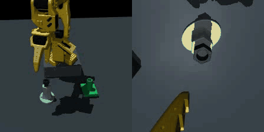
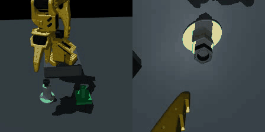
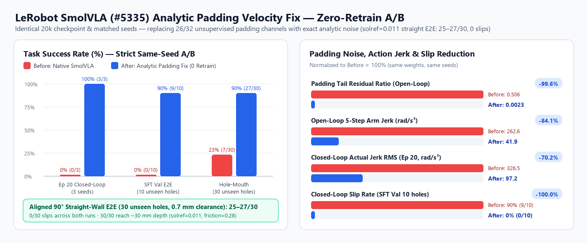
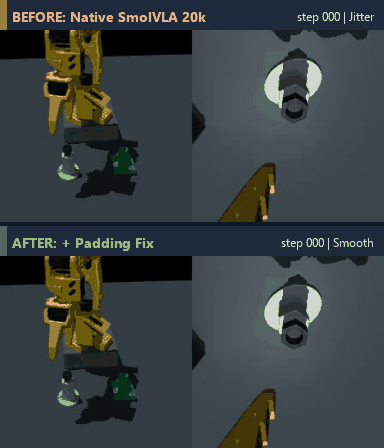

# SO-101 Precision Bolt Insertion: SmolVLA Fine-Tuning & LeRobot Inference Fix

[](https://pytorch.org/)
[](https://mujoco.org/)
[](https://github.com/huggingface/lerobot)
[](https://github.com/google-deepmind/mujoco_menagerie/tree/main/robotstudio_so101)
[](patches/smolvla-padding-velocity.patch)

[中文](README.md) | **English**

Closed-loop 25 Hz dual-camera `SmolVLA` control of a 5-DoF SO-101 arm in MuJoCo for picking a bolt from a fixed holder, transporting, and inserting it into randomized **90° straight-walled holes with 0.7 mm radial clearance and zero chamfer** (±18 mm target range). Under realistic plastic contact alignment, **the patched 20k SmolVLA checkpoint achieves `25–27/30` (83%–90%) end-to-end insertions with `0` slips across 30 unseen holes**, reaching ~30 mm insertion depth on `30/30` episodes. Along the way, we diagnosed and fixed an upstream LeRobot `SmolVLA` Flow-Matching inference bug (`#5335`) with **zero retraining**.

<p align="center">
  
  
</p>

<p align="center">
  <em>End-to-end closed-loop rollouts on unseen held-out holes (left: top camera, right: wrist camera). <a href="experiments/smolvla-20k/demo-episodes.json">Targets, seeds, and rollout log</a></em>
</p>

---

## Key Discovery: Zero-Retrain Fix for LeRobot SmolVLA Padding Drift (`#5335`)

The SO-101 robot uses **6** joint dimensions while `SmolVLAConfig.max_action_dim = 32`, leaving **26/32 (81.25%)** channels as zero-padded dimensions. During training, loss is computed only on the first 6 active dimensions; during inference, however, `euler_integrate` integrates all 32 dimensions and feeds them back through `action_in_proj` at every denoising step. Unsupervised drift in the 26 padding channels leaks directly into the 6 physical joints, causing severe high-frequency jitter and gripper slips.

In [patches/smolvla-padding-velocity.patch](patches/smolvla-padding-velocity.patch), we replace the predicted velocity on padded channels with the exact analytic velocity field $\frac{dx_{\text{pad}}}{dt} = \epsilon_{\text{pad}}$. With **identical weights and zero retraining**, jitter and slips drop sharply across every matched-seed benchmark:

<p align="center">
  
</p>

<p align="center">
  
</p>

| Matched-Weight / Matched-Seed A/B | Before (Native SmolVLA 20k) | After (+ Analytic Padding Fix) | Delta | Evidence |
| --- | ---: | ---: | ---: | --- |
| Ep 20 Open-Loop Padding Tail Ratio | `0.506` | **`0.0023`** | **-99.6%** | [padding-ab-ep20.json](experiments/smolvla-20k/padding-ab-ep20.json) |
| Ep 20 Open-Loop 5-Step Arm Jerk | `262.6 rad/s³` | **`41.9 rad/s³`** | **-84.1%** | [padding-ab-ep20.json](experiments/smolvla-20k/padding-ab-ep20.json) |
| Ep 20 Closed-Loop Insertions (3 seeds) | `0/3` | **`3/3`** | **+100%** | [padding-ab-ep20.json](experiments/smolvla-20k/padding-ab-ep20.json) |
| SFT Validation E2E (10 unseen holes) | `0/10` (9 slips) | **`9/10` (0 slips)** | **+90%** | [padding-sft-val10.json](experiments/smolvla-20k/padding-sft-val10.json) |
| Hole-Mouth Pre-Aligned (30 holes) | `7/30` (12 slips) | **`27/30` (0 slips)** | **+67%** | [hole-mouth-30.json](experiments/smolvla-20k/hole-mouth-30.json) |

### Applying the Patch

```bash
git apply patches/smolvla-padding-velocity.patch
```

Pass `correct_padding_velocity=True` to `select_action` / `predict_action_chunk` (defaults to `False` for backward compatibility). See [patches/smolvla-padding-velocity.patch](patches/smolvla-padding-velocity.patch).

---

## End-to-End Evaluation (30 Unseen Random Holes)

- **Training Dataset**: 150 demonstrations at 25 Hz (**28,649 frames**, [dataset.json](experiments/smolvla-20k/dataset.json)); dual 224×224 RGB + 6-DoF state → 6-DoF absolute joint targets (chunk size 25, replan every 5 steps).
- **Arrival Accuracy**: At 15 mm above the hole mouth, median XY error is **`1.32 mm`** and tilt is **`0.86°`**; at first contact, median XY error is **`1.20 mm`** and tilt is **`0.83°`**.
- **Strict Evaluation Spec**: **90° straight wall (no chamfer)**, **0.7 mm radial clearance**, `3.0 mm` penetration failure guardrail, and `0.200 s` continuous seating (100 physics ticks at 500 Hz).

| Contact Regime | Policy (Same 30 Held-Out Holes) | Insertions | Slips | Timeouts / Pen. | Evidence |
| --- | --- | ---: | ---: | ---: | --- |
| **Aligned Straight Wall** (`solref=0.011`, `friction=0.28`, `0 chamfer`) | **Patched SmolVLA 20k (Run 1)** | **25/30 (83.3%)** | **0** | 3 / 2 | [straight-solref011-run1.json](experiments/smolvla-20k/straight-solref011-run1.json) |
| **Aligned Straight Wall** (`solref=0.011`, `friction=0.28`, `0 chamfer`) | **Patched SmolVLA 20k (Run 2, same seeds)** | **27/30 (90.0%)** | **0** | 1 / 2 | [straight-solref011-run2-force-gate.json](experiments/smolvla-20k/straight-solref011-run2-force-gate.json) |
| **Aligned Straight Wall** (`solref=0.011`, `friction=0.28`, `0 chamfer`) | **Hold-Extension Fine-Tune v2 (5-DoF matched, 22k)** | **24/30 (80.0%)** | **0** | 3 / 3 | [hold-finetune-v2-comparison.json](experiments/smolvla-20k/hold-finetune-v2-comparison.json) |
| **Aligned Straight Wall** (`solref=0.011`, `friction=0.28`, `0 chamfer`) | Hold-Extension Fine-Tune v1 (4-DoF locked roll, 23k) | 22/30 (73.3%) | 0 | 2 / 6 | [hold-finetune-v1-comparison.json](experiments/smolvla-20k/hold-finetune-v1-comparison.json) |
| Legacy Stiff Wall (`solref=0.006`, `friction=0.50`) | Patched SmolVLA 20k (Run 1 / Repeat) | 21/30 · 23/30 | 0 · 1 | 9 · 7 | [end-to-end-30.json](experiments/smolvla-20k/end-to-end-30.json) · [repeat](experiments/smolvla-20k/end-to-end-30-repeat.json) |
| Legacy Stiff Wall (`solref=0.006`, `friction=0.50`) | Full-Action BC Actor (6 mm handoff) | 21/30 | 0 | 9 | [stage-a-bc.json](experiments/smolvla-20k/stage-a-bc.json) |
| Legacy Stiff Wall (`solref=0.006`, `friction=0.50`) | Online RL-Token (10k, two rollouts) | 11/30 · 12/30 | 0 · 1 | 19 · 17 | [online-rl.json](experiments/smolvla-20k/online-rl.json) |
| Legacy Stiff Wall (`solref=0.006`, `friction=0.50`) | DAgger Continuation (25k) | 18/30 | 9 | 12 | [dagger-eval.json](experiments/smolvla-20k/dagger-eval.json) |

---

## Failure Attribution & Falsified Post-Training Branches

Every post-training branch was audited with zero-training gates or frozen-weight diagnostics (detailed Chinese notes in [docs/engineering-notes.md](docs/engineering-notes.md)):

| Branch | Outcome | Key Quantitative Evidence |
| --- | --- | --- |
| **Online RL-Token** | Regressed on unseen holes | Monitored holes rose `8/10 → 9/10`, but 30 unseen holes dropped to `11–12/30` (`26.1 mrad` P95 takeover jump disturbed clean arrivals) [online-rl.json](experiments/smolvla-20k/online-rl.json) |
| **DAgger 25k** | 5-DoF IK null-space drift | Frozen 20k flow loss: `0.000331` (original) vs `23.58` (teacher); `wrist_roll` alone accounted for **81.1%** of teacher batch loss [dagger-frozen-loss.json](experiments/smolvla-20k/dagger-frozen-loss.json) |
| **Force-Feedback Unloading Gate** | Falsified at Step 0 (0 training) | Oracle unloading triggers achieved **`0/14`** insertions (max streak `100 ms` < `200 ms`); actuator torque AUROC was **`0.729`** [straight-solref011-run2-force-gate.json](experiments/smolvla-20k/straight-solref011-run2-force-gate.json) |
| **Hold-Extension Continuation (v1 / v2)** | Recovers old misses but trades holes (`24–25/30`) | v1 (4-DoF locked roll) caused frozen `wrist_roll` shock (`4.51`) and dipped `25→1→22/30` (rescued `[2,5,12,13,28]`, lost 8)[v1](experiments/smolvla-20k/hold-finetune-v1-comparison.json); v2 (5-DoF matched prefix `wrist_roll 0.170` vs val `0.177`) held `0` slips throughout and reached `24/30` at 22k (rescued `[2,12,13]`, rotated 4 marginal holes)[v2](experiments/smolvla-20k/hold-finetune-v2-comparison.json) |
| **Remaining Hardware Ceiling (3–5/30)** | Physical SO-101 5-DoF vision-only limit | `30/30` enter `29.5–32.4 mm`; vision error (`1.20 mm`) > radial clearance (`0.7 mm`), zero force sensing, rigid position servos (`kp=998.22`), missing lateral wrist-tilt DoF, and hinged-jaw upward creep (`~2 mm/s`) create an `80%–90%` plateau where marginal holes rotate rather than vanish |

---

## Core Repository Map

While `examples/so101_insertion/` preserves the full exploration history, the main pipeline rests on these core files:

| Path | Role |
| --- | --- |
| [patches/smolvla-padding-velocity.patch](patches/smolvla-padding-velocity.patch) | **Core Fix**: Analytic padding velocity patch for LeRobot `SmolVLA` |
| [examples/so101_insertion/scene.py](examples/so101_insertion/scene.py) | MuJoCo SO-101 scene & straight-wall contact parameters (`solref=0.011`, `friction=0.28`) |
| [examples/so101_insertion/smolvla25_data.py](examples/so101_insertion/smolvla25_data.py) | 25 Hz environment, demonstration collection, 200 ms seating & 3 mm penetration checks |
| [examples/so101_insertion/smolvla25_train.py](examples/so101_insertion/smolvla25_train.py) | SmolVLA SFT fine-tuning & weighted continuation training |
| [examples/so101_insertion/smolvla_padding_e2e30.py](examples/so101_insertion/smolvla_padding_e2e30.py) | Patched (`corrected=True`) 30-hole end-to-end evaluation & telemetry |
| [examples/so101_insertion/smolvla_dagger_loss_audit.py](examples/so101_insertion/smolvla_dagger_loss_audit.py) | Frozen-weight per-axis flow loss diagnostic (`wrist_roll` 81.1% attribution) |
| [examples/so101_insertion/smolvla_force_gate_step0.py](examples/so101_insertion/smolvla_force_gate_step0.py) | Step-0 oracle unloading & torque AUROC diagnostic |
| [examples/so101_insertion/smolvla_hold_finetune.py](examples/so101_insertion/smolvla_hold_finetune.py) | 25-frame static hold collection, split prefix/tail 6-DoF loss audit, continuation & 30-hole eval |
| [README-pi05-50hz.md](README-pi05-50hz.md) | Earlier π0.5 / 50 Hz exploration archive |

---

## Credits & Third-Party Notices

Place `examples/so101_insertion/` inside a matching [LeRobot checkout](https://github.com/huggingface/lerobot/tree/4aaff99be4a1d81568c08c8f0296b41b40c99ec4). Robot assets follow [MuJoCo Menagerie SO-101](https://github.com/google-deepmind/mujoco_menagerie/tree/370c43965323c0944b433b202aac5058b5f907a9/robotstudio_so101) and RL-Token baselines reference [RL-Token-Pi05-open](https://github.com/Zhengsw03/RL-Token-Pi05-open/tree/e3c1f4517108fdff66d93b68bae3a16fc1cd5dd3).

See [third_party](third_party) for licenses and notices.
